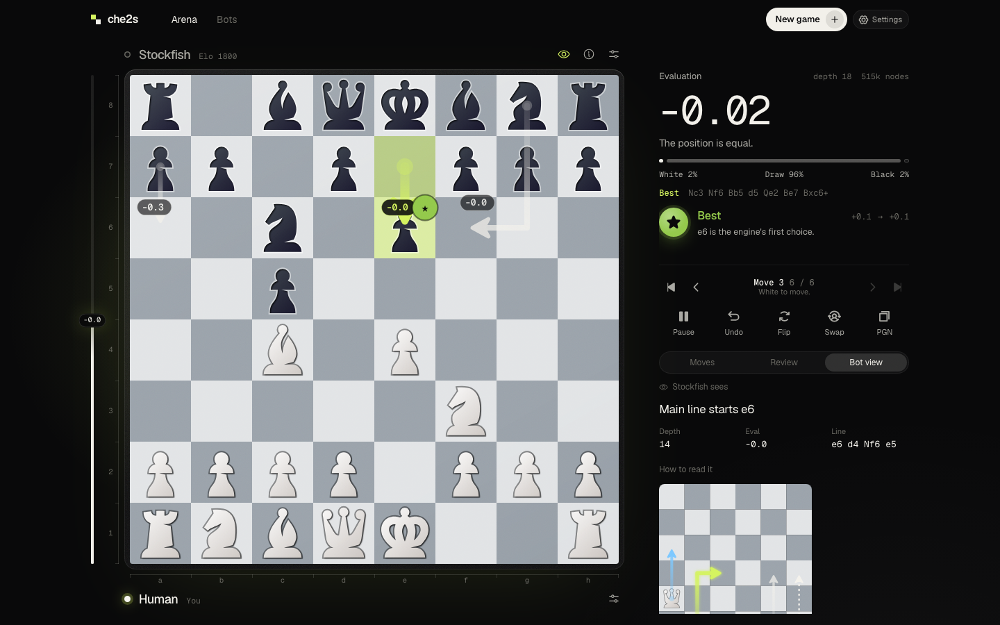
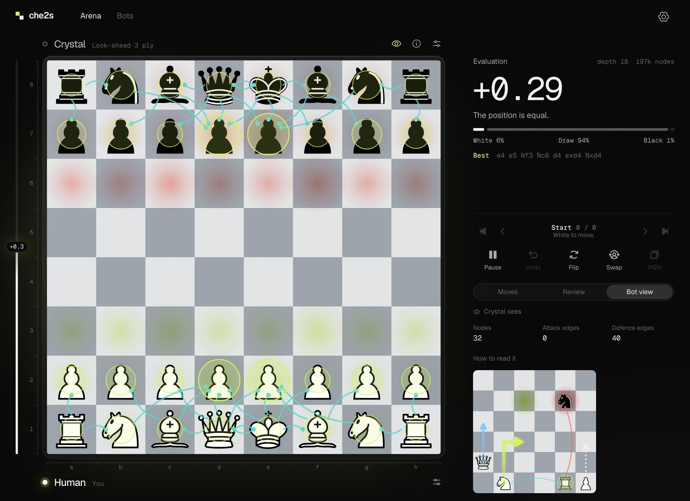
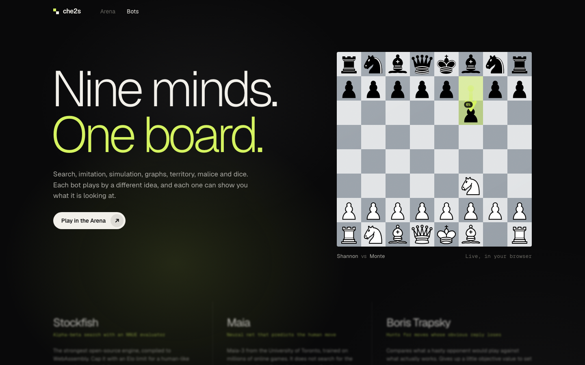

# che2s

**A chess arena for engines and humans.** Play Stockfish, Maia and seven stranger bots, set any two of them
against each other, and switch on an overlay that shows what each one is looking at. A full-strength
Stockfish judge scores every position live, rates every move from Brilliant to Blunder, and walks you
through the game afterwards.

Everything runs in the browser: WebAssembly Stockfish, an ONNX neural network for Maia, and the
JavaScript bots in a Web Worker. There is no backend, and the heavy files (engine, neural-net runtime,
model) come from public CDNs straight into the browser's cache, so the host only serves the app itself.



## Contents

- [Features](#features)
- [The bots](#the-bots)
- [Getting started](#getting-started)
- [How it works](#how-it-works)
- [Adding a bot](#adding-a-bot)
- [Adding a UCI engine](#adding-a-uci-engine)
- [Adding a neural network](#adding-a-neural-network)
- [Testing](#testing)
- [Deploying](#deploying)
- [License](#license)

## Features

- **Any matchup.** Each side can be a human or any bot: human against bot, bot against bot, or two humans
  at one keyboard. Bot games have a pace slider and Pause.
- **Tunable bots.** Every bot has its own settings (Elo, depth, temperament), edited in a side sheet.
  Bots hold their move while the sheet is open.
- **See what a bot sees.** Each bot can draw its thinking on the board as candidate arrows, heatmaps, an
  attack/defence graph or a territory map. A hover/tap legend board explains every mark.
- **Live judge.** Stockfish 19 at full strength reports the score, win/draw/loss odds, mate-in-N, depth,
  nodes and best line, plus an eval bar beside the board. Every part can be switched off.
- **Live move ratings.** Every move is rated (Brilliant, Great, Best, Excellent, Good, Inaccuracy, Mistake,
  Miss, Blunder) with a plain-language reason: what it allows, what material it loses, what was better.
- **Game review.** Accuracy for both sides, an evaluation graph, counts per category, and a step-through
  or auto-play walkthrough of every move.
- **The rest.** Captured pieces with material balance, check and thinking indicators, promotion picker,
  takeback, flip, swap, PGN copy, FEN/PGN load, five piece sets and five board colours. The board turns
  automatically when a lone human plays Black.



## The bots

| Bot | Idea | What its overlay shows |
| --- | --- | --- |
| **Stockfish** | Alpha-beta search with an NNUE evaluator; Elo cap 1320-3190 or full strength | Candidate lines with evaluations |
| **Maia** | Maia-3 neural network trained on human games; predicts the human move at a rating (600-2600) | Probability of each move, heatmap of human choices |
| **Boris Trapsky** | Compares a 1-ply "hasty" view of your replies with a deep one; prefers moves whose natural reply loses | The bait and the punishment behind it |
| **Crystal** | The board as a graph of attacks and defences, scored with PageRank | The live attack/defence graph |
| **WorstFish** | Asks Stockfish to rank every move, then plays from the bottom | Best move avoided vs move chosen |
| **Shannon** | Textbook iterative-deepening alpha-beta with quiescence over piece-square tables | Root move scores and the principal line |
| **Monte** | UCT Monte-Carlo tree search with capture-biased random playouts | Where the simulations went |
| **Meridian** | Chess like Go: influence spreads from every piece, territory and king-zone pressure decide | Territory map, White lime and Black orange |
| **Dice** | Random legal moves, optionally greedy for captures and checks | Every legal destination |



## Getting started

Requirements: Node.js 22 or newer (Astro 7).

```bash
npm install
npm run dev          # http://localhost:4321
```

Optional, for development: keep Maia's 44 MB network on disk instead of downloading it on first use.
Only the dev server uses this copy; production always downloads the model in the browser.

```bash
npm run fetch:maia   # saves public/models/maia3_simplified.onnx (git-ignored)
```

Other scripts:

| Command | What it does |
| --- | --- |
| `npm run build` | Static production build into `dist/` |
| `npm run preview` | Serve the production build locally |
| `npm run check` | Type-check (Astro + TypeScript) |
| `npm test` | Playwright end-to-end and bot tests |

Keyboard: `←` `→` step through moves, `Home` / `End` jump, `F` flips the board, `Space` pauses bots.

## How it works

```
engines/stockfish/  Stockfish 19 lite (JS + WASM), served to browsers by jsDelivr from this repo, never deployed
src/
  pages/            index.astro (the arena), bots.astro (the roster)
  components/       Arena (game state + layout), Board (chessground), Overlay (HUD drawing),
                    SeatSheet / GameSheet (settings), ReviewPanel, MiniMatch
  lib/
    bots/           one file per bot + index.ts (the registry)
    brain.worker.ts runs bot.think() off the main thread, one Stockfish per bot
    brain.ts        main-thread client for the worker
    stockfish.ts    UCI wrapper; loads Stockfish from jsDelivr (unpkg as fallback) in a blob worker
    useJudge.ts     live judge (its own Stockfish instance)
    review.ts       cached analyst, move classification, explanations, full review
    chess.ts        helpers over chessops (moves as standard UCI, SAN, scores, captures)
    types.ts        BotDef, Setting, Hud, Legend
tests/              Playwright specs (browser) and headless bot checks
```

- **Rules and moves** come from [chessops](https://github.com/niklasf/chessops). Moves cross every module
  boundary as standard UCI strings (castling is `e1g1`).
- **Bots** are plain objects that implement `BotDef`. The arena sends `think()` calls to a Web Worker, so
  even a synchronous search never freezes the UI. HUD frames stream back while the bot thinks.
- **The judge** and **live ratings** each use their own Stockfish, so they never interfere with the bots.
  Analyses are cached per position, and the end-of-game review reuses them.

## Adding a bot

A bot is one file and one line in the registry. Nothing else needs wiring: the seat picker, settings
sheet, HUD toggle, legend, Bots page and spec sheet all read from the registry.

### 1. Write the bot

Create `src/lib/bots/<id>.ts`:

```ts
import type { BotDef } from '../types';
import { fromFen, legalMoves, parseSquare, VALUE } from '../chess';

export const greedy: BotDef = {
  id: 'greedy',                        // used in URLs: /?black=greedy
  name: 'Greedy',
  approach: 'Takes the biggest capture it can see',
  description: 'Captures the most valuable piece available, otherwise plays at random.',
  vision: 'Targets',                   // short name for the overlay
  hud: 'Captures it considered',       // one line on what the overlay shows
  legend: [
    { mark: 'pick', text: 'The move it played' },
    { mark: 'alt', text: 'Other captures it saw' },
  ],
  settings: [
    { key: 'patience', label: 'Patience', hint: 'Chance to skip a capture', type: 'range', min: 0, max: 100, step: 5, default: 0, unit: '%' },
  ],
  async think({ fen, settings }) {
    const pos = fromFen(fen);
    const moves = legalMoves(pos);
    const gain = (uci: string) => VALUE[pos.board.getRole(parseSquare(uci.slice(2, 4))!) ?? 'king'];
    const captures = moves.filter((m) => gain(m) > 0).sort((a, b) => gain(b) - gain(a));
    const take = captures.length > 0 && Math.random() * 100 >= (settings.patience as number);
    const move = take ? captures[0] : moves[Math.floor(Math.random() * moves.length)];
    const arrow = (m: string, tone: 'pick' | 'alt') => ({ from: m.slice(0, 2), to: m.slice(2, 4), tone });
    return {
      move, // standard UCI: "e2e4", "e7e8q", castling "e1g1"
      hud: {
        arrows: [arrow(move, 'pick'), ...captures.filter((m) => m !== move).slice(0, 3).map((m) => arrow(m, 'alt'))],
        caption: take ? `Took the biggest prize on ${move.slice(2, 4)}.` : 'Nothing worth taking, so a random move.',
        stats: [['Captures', String(captures.length)]],
      },
    };
  },
};
```

### 2. Register it

Add it to `BOTS` in `src/lib/bots/index.ts`. The array order is the order shown in the UI.

```ts
import { greedy } from './greedy';
export const BOTS: BotDef[] = [stockfish, maia, /* ... */, greedy];
```

### 3. Test it

Add its id to `BOTS` in `tests/arena.spec.ts` (it then must play a legal move in the browser). If the bot
is pure JavaScript, also add it to the lists in `tests/bots.spec.ts`, which run it headless on tricky
positions (castling, promotion, mate in one).

```bash
npm test
```

### The `BotDef` contract

| Field | Purpose |
| --- | --- |
| `id`, `name`, `approach`, `description` | Identity, shown in the seat picker and on the Bots page |
| `vision`, `hud`, `legend` | Overlay name, one-line summary, and the marks the overlay can draw |
| `settings` | Knobs rendered automatically. `range` (`min`, `max`, `step`, `unit`), `toggle`, or `choice` (`options`). Set `off: '<toggleKey>'` to disable a setting while that toggle is on (e.g. Elo at full strength). |
| `think(input, ctx)` | Returns `{ move, hud? }`. `input` has `fen`, `moves` (UCI history), `startFen` and `settings` with defaults applied. |
| `view?(fen)` | Optional, synchronous. A HUD for any position, drawn live as the user steps through moves (Crystal and Meridian use it). |

`ctx` gives the bot:

| Member | Use |
| --- | --- |
| `ctx.emit(hud)` | Stream an in-progress HUD (throttled), e.g. after each search iteration |
| `ctx.status(text)` | Short status in the seat's thinking label, e.g. download progress |
| `ctx.engine()` | A Stockfish instance private to this bot (see below) |
| `ctx.aborted()` | `true` once the game moved on. Check it in long loops and `await` a tick now and then so cancellation arrives. |

### The HUD

Every field of `Hud` is optional. The overlay draws whatever is present:

| Field | Drawn as |
| --- | --- |
| `arrows: { from, to, tone, weight?, label? }[]` | Rounded arrows; knight moves bend into an L. Tones: `pick` (its move, lime), `alt` (candidates, white), `bad` (bait or blunder, coral), `line` (continuation, amber). `judge` and `better` are reserved for the app. |
| `heat: { [square]: -1..1 }` | Soft blobs under the pieces; positive is lime, negative coral |
| `field: { [square]: -1..1 }` | Square tints by owner; positive White (lime), negative Black (orange) |
| `graph: { nodes, edges }` | Rings sized by importance; curved attack (coral) and defence (teal) edges |
| `caption`, `stats` | Text in the Bot view tab |

Legend marks are the arrow tones plus `heat`, `heat-bad`, `field-white`, `field-black`, `node`, `attack`
and `defend`. The legend board draws a demo of each mark you list.

### Shared building blocks

`src/lib/bots/eval.ts` has fast move generation (`genMoves`), MVV-LVA ordering (`orderKey`), capture
detection, a piece-square evaluation and `yieldNow()`. Shannon, Crystal, Monte and Meridian are all short,
readable starting points for a search-based bot.

## Adding a UCI engine

`ctx.engine()` hands each bot its own Stockfish. The wrapper in `src/lib/stockfish.ts` speaks plain UCI, so
any engine compiled to a WASM web worker works the same way:

1. Ship the engine's `.js` and `.wasm`. Either put them in `public/engine/` and pass a same-origin URL, or
   (to keep them off your host, as Stockfish is) commit them under `engines/` and load them from jsDelivr,
   following `SOURCES` and `cdnWorker()` in `stockfish.ts`. Browsers refuse cross-origin worker scripts, so
   CDN builds start in a same-origin blob worker that `importScripts()` the CDN file.
2. Create one instance in your bot file, lazily, and reuse it:

   ```ts
   import { Stockfish } from '../stockfish';

   let engine: Stockfish | null = null;
   const get = () => (engine ??= new Stockfish('/engine/my-engine.js'));

   // inside think():
   const sf = get();
   await sf.setOptions({ Hash: 32 });
   const { bestmove, lines } = await sf.analyse(fen, { movetime: 1000 }, 3, (partial) => ctx.emit(toHud(partial)));
   return { move: bestmove };
   ```

`analyse(fen, go, multipv, onInfo)` accepts `{ depth }`, `{ movetime }` or `{ nodes }` and resolves to
`bestmove` plus the lines, scored from the side to move. Searches on one instance run one at a time, and
`stop()` ends the current one. Multi-threaded WASM builds need cross-origin isolation headers; the
single-threaded builds used here do not.

To upgrade Stockfish: bump the exact `stockfish` version in `package.json` and `STOCKFISH_VERSION` in
`stockfish.ts`, then copy the new lite single-threaded files from `node_modules/stockfish/bin/` into
`engines/stockfish/` (updating the constant `FILE` if the name changed).

## Adding a neural network

Maia (`src/lib/bots/maia.ts`) is the template:

- `onnxruntime-web` is imported dynamically inside `think()`, so it only loads when the bot plays.
- The model is downloaded once with streamed progress (`ctx.status`) and cached with the Cache Storage
  API. In development a copy in `public/models/` is used when present.
- The ONNX Runtime JS glue and `.wasm` load from jsDelivr at exactly the version that was bundled
  (`ort.env.versions.web`); the build aliases `onnxruntime-web/wasm` to the variant that embeds no `.wasm`.
- Encode the position into the network's input tensor, mask illegal moves, softmax what is left, and
  return the best (or a sampled) move with the probabilities as the HUD.

## Testing

```bash
npx playwright install chromium   # once
npm test
```

The suite starts the dev server if one isn't already running on port 4321. It covers human moves and
bot replies, every bot playing a legal move in the browser, Maia downloading and answering 1.e4 like a
human, HUD overlays and legends, bot-vs-bot with pause, PGN and FEN loading, checkmate detection, live
ratings and their explanations, the review walkthrough, promotion, the judge's mate announcements,
settings persistence, and headless checks of the JavaScript bots (legal moves, castling, mate in one).

## Deploying

`npm run build` produces a fully static site in `dist/` (about 1 MB), so it can go on any static host. On
Vercel, import the repository and keep the detected Astro settings. No adapter, server or special headers
(COOP/COEP) are needed.

Your host serves only the app (about 0.6 MB per visitor). Everything heavy is downloaded by the browser
from public CDNs and cached there:

| Asset | Size | Loaded from | When |
| --- | --- | --- | --- |
| Stockfish 19 lite (JS + WASM) | 1.8 MB | jsDelivr (this repo's `engines/stockfish`), unpkg fallback | Every arena visit (the judge uses it) |
| ONNX Runtime (JS + WASM) | 14 MB | jsDelivr (npm `onnxruntime-web`) | Only when Maia plays |
| Maia-3 model | 44 MB | GitHub (CSSLab), or `PUBLIC_MAIA_URL` | Only when Maia plays; kept in Cache Storage |

- jsDelivr serves `engines/stockfish` from the default branch of this repository, so the repository must
  be public and pushed before the engine can load.
- GitHub is not a CDN, so it can be slow or throttled for the Maia model. For heavy traffic, host
  `maia3_simplified.onnx` somewhere with CORS enabled (Cloudflare R2, a Hugging Face repository) and set
  `PUBLIC_MAIA_URL` at build time.

## License

che2s is free software under the **GNU General Public License v3.0 or later**; see [`LICENSE`](LICENSE).
It has to be: it ships Stockfish (GPL-3.0) and is built on chessground and chessops (GPL-3.0-or-later).
If you host a modified version, make its source available to your users. Maia's network and move
vocabulary are AGPL-3.0, from the University of Toronto's CSSLab.

Piece sets, fonts and other third-party components keep their own licenses, listed in
[`THIRD-PARTY-NOTICES.md`](THIRD-PARTY-NOTICES.md).
